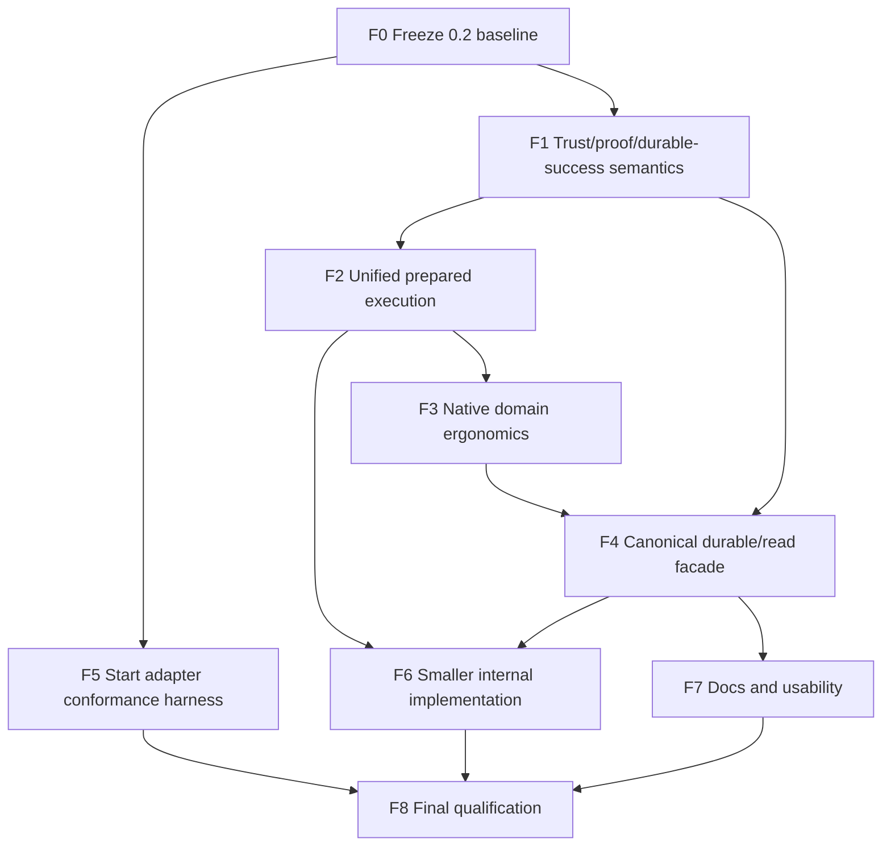

# StateChronicle 0.3.0 — Coherence, Usability & Maintainability Refactor

> **Status:** Proposed engineering roadmap; not an implemented release or an assertion that all listed risks are confirmed defects.\
> **Baseline:** `STEXS-Technologies/statechronicle` tag `v0.2.0`, commit `c418e98b91720188158c531cd5c2c4b8ab71cbcf` (the inspected `main` was identical).\
> **Baseline release:** 2026-10-10. **Plan prepared:** 2026-11-16.\
> **Scope:** StateChronicle library, portable crates, public API, internal composition, conformance tooling, documentation, verification and performance. No deployment service or mandatory database/runtime.\
> **Working branch suggestion:** `refactor/coherent-0.3` (create only after the baseline is frozen).

## 0. Executive decision

**0.3.0 is a quality release, not a feature-accumulation release.** The goal is to make StateChronicle *smaller where code is redundant, simpler where contracts are fragmented, easier to integrate without understanding the whole workspace, and harder to misuse*—without weakening its defining guarantees: deterministic state transitions, authenticated and authorized mutations, idempotency, atomic canonical commits, signed append-only history, replay, sparse-Merkle commitments, and independently verifiable proofs.

0.2.0 already implements significant capabilities. The next engineering challenge is **making the correct path the easiest path** and eliminating redundant decision, decoding, validation, wiring and read-side flows. The work should be proven through retained 0.2 reference fixtures, adversarial differential tests, an independent adapter-conformance harness, and matched performance measurements.

**Success is not measured by renaming modules or adding one more facade.** Success means:

1. Consumer workflows have one obvious canonical API for each intent: **prepare/plan**, **durably commit**, **verify current state**, **verify historical state**, **recover/rebuild**.
2. The correct trust and transaction authority is enforced by types and private constructors where feasible; callers cannot casually confuse a planned event, a validated event, a signed commit, a durable receipt, and a verified claim.
3. A custom domain defines its rules and native types once; the standard path avoids redundant decoding, reduction and validation without weakening checks.
4. The same semantic invariant has one authoritative implementation; duplicated wrappers are thin, deliberate and compatibility-tested.
5. Consumer adapters can be conformance-tested rather than relying on prose to satisfy atomicity and recovery contracts.
6. Net implementation complexity decreases. Production code footprint, duplicate logic, build cost, compilation graph, allocations and hot-path latency are measured at every refactor checkpoint.
7. All 0.2 protocol representations, cryptographic vectors, old histories, and existing supported behaviors remain compatible unless an intentional, documented breaking change is necessary for security—and even then, use a migration path where possible.

### Non-goals

- No new database service, HTTP layer, queue, scheduler, KMS or authorization provider in the library.
- No mandatory dependency on Penelope, TrustGrant or Shardline. Integrate through ports and externally verified receipts.
- No rewrite of cryptography, accumulator structure, consensus model, hashing, signatures, key formats, Merkle proof layout, canonical BCS, or historical identity generation for stylistic reasons.
- No generic “one trait to own all transitions, transactions, history and proofs.” Those are separate trust/atomicity boundaries.
- No blanket replacement of typed identifiers with strings, broad `dyn` erasure, unchecked conversions, or silent schema migration.
- No claim of exactly-once delivery, universal distributed atomicity, or proof of *physical* truth from cryptographic consistency alone.

---

## 1. Grounded 0.2.0 inventory and the starting problem

The baseline has **13 library crates** plus `fuzz`. GitHub's tracked tree shows **113 Rust source files under `crates/*/src/`, totalling 1,348,105 bytes**. These figures measure tracked source bytes, not effective LOC or compiled size; establish those separately in F0.

| Ownership today | Crates / files to examine | Observed role and pressure |
|---|---|---|
| Public entry point | `crates/statechronicle/src/lib.rs` | Umbrella exposes underlying crates, flat aliases and several separate port/pipeline surfaces. |
| Native custom model | `statechronicle-profile/src/contract.rs`; `statechronicle-profiles/src/custom.rs` | `StateProfile` plus `TypedProfile` plus `ProfileRules`; command and state may be decoded/validated repeatedly. |
| Protocol executor | `statechronicle-executor/src/pipeline.rs` (~68 KB); `conflict.rs`; `settlement.rs` | Ingress, verification, authorization, state resolution, transition, planning, batch semantics and sink dispatch mixed in a large module. |
| Profile semantics | `statechronicle-profiles/src/registry.rs`, `execution.rs`, `transition.rs` (~61 KB), `atomicity.rs` (~101 KB) | Correctly distinct domain rules, but several layers of selectors, wrappers and string/JSON command bridging. |
| Commit authority | `statechronicle-commit/src/persist.rs` (~39 KB), `batch.rs`, `builder.rs`, `roots.rs` | Verified durable write exists; multiple API lanes expose overlapping-looking persistence concepts. |
| Ports | `statechronicle-ports/src/{ledger_store,transaction_manager,intent_store,event_store,commit_store,authorization,outbox,...}.rs` | Several logical read/write ports; only ledger transaction owns the authoritative full mutation boundary. |
| Proofs and read services | `statechronicle-proof/src/{service,verify,trade,bundle,custom}.rs` | Pure verification and service wrappers; current/historical proof semantics and caller's expected key must be made obvious. |
| Sparse-Merkle core | `statechronicle-accumulator/src/sparse_merkle.rs` (~80 KB) | Security-critical, mature algorithm; split only along proven internal ownership, never change representation casually. |
| Replay/indexing | `statechronicle-index/src/{build,rebuild,history,service}.rs` | Rebuild and trade read projections; verify common canonical history rules are shared, not reinterpreted. |
| Portable path | `statechronicle-portable/*` | Allocation-free, `no_std` profile execution, encoding, integrity and verification must stay viable. |

**Released evidence to preserve:** The 0.2.0 acceptance audit reports 794 passing workspace tests, 25 instrumented fuzz targets, 94.50% protocol-surface line coverage (92.4% ratchet) and 91.37% unfiltered workspace line coverage, plus portability, versioned-recovery, signing, proof and canonical-vector gates. This is *historical release evidence*, not a new run against 0.3.0.

**Key diagnosis:** Code is organized by technical protocol ownership, but users still encounter many parallel names and workflows: `StateProfile`, `ProfileRules`, `TypedProfile`; `Executor`, `Ports`, `CommitPorts`, `ProofPorts`; `execute*` planning/authorization/durability variants; `LedgerStore` versus `TransactionManager`; `verify` versus `verify_canonical`. These differences are often semantically necessary **inside** the implementation. They do not all need to be exposed as equally natural **consumer** entry points.

### 1.1 Invariants the refactor must not lose

**Transition:** deterministic application reduction, before/after state binding, checked version increment, input validation, profile addressing and state-type agreement, no mutation on refusal.\
**Identity:** tenant/actor/resource/intent/event/profile/schema/commit scopes, canonical digest, domain separation, signed command-to-operation binding.\
**Authority:** authenticated principal binding; key scope, time and revocation policy; delegated-authority freshness and aggregation; fail-closed policy errors.\
**Ledger:** idempotency claim + events + signed commit + canonical head + projection updates + outbox in one supported atomic transaction; exact retry and ambiguous-ACK lookup; no fictitious distributed transaction.\
**History/proofs:** append-only canonical history, stable BCS vectors, SHA-256 and Ed25519 verification, state-root and sparse-Merkle proof checks, separately asserted signer trust, explicit current-head freshness.\
**Recovery:** no accepted partial mutation; replay/rebuild agrees with canonical history; no blind retry after uncertain external or persistence results; versioned custom-domain migration remains explicit.\
**Portability:** allocation-free supported portable operations, `no_std` targets, bounded buffers and deterministic refusal on capacity exhaustion.

### 1.2 Why smaller code is a real deliverable

Use **production-only** metrics (exclude test modules, fixtures, generated output, comments and documentation) with the same parser and methodology for every revision. Track:

- Physical Rust source lines, executable code lines, Rust lexical tokens, number of public items, number of control-flow branches in each authoritative pipeline, and approximate cyclomatic complexity at hotspots.
- Duplicate whole functions **and** partial/semantic duplication (decode, validation, domain dispatch, retry policy, signature lookup, scope checks, proof-store lookup).
- Compiled dependency graph, feature graph, facade cold-build time, number of compiled crates, final binary size in a controlled consumer, and portable core size.
- Workload-specific median/p95/p99 latency, ops/s, allocation count/bytes and instruction counts where practical.
- Number of independent concepts and required setup steps in a fresh consumer, not just the number of exported aliases.

**Footprint target:** Seek a **10–20% reduction in production code inside existing duplicated orchestration/adapter/glue hotspots**, conditional on equivalence. Do not declare a universal 10–20% overall workspace reduction: adding adapter conformance, ergonomics and stricter trust checks may legitimately add code. The whole-workspace target is **flat or reduced production footprint after the new functionality is accounted for**; if it grows, publish a justified delta and an explicit ownership/maintenance benefit. Never delete safety checks to meet a LOC quota.

---

## 2. Desired 0.3.0 architecture

```text
                           Consumer application
                  (transport, auth principal, storage, keys)
                                   |
                    Canonical StateChronicle facade
                                   |
               +-------------------+------------------+
               |                   |                  |
           domain/profile       mutation            query/proof
       typed models & rules    preparation           verification
               |                   |                  |
               |            verified ingress         |
               |                   |                  |
               +----------> Prepared transition      |
                                   |                  |
                             signed commit plan      |
                                   |                  |
                 authorized atomic LedgerTransaction  |
                 claim + events + commit + projections|
                        + canonical head + outbox     |
                                   |                  |
                       committed receipt / lookup    |
                                   |                  |
                   replay / projection reconstruction-+
                                   |
                      independently trusted proof
                 (history pin OR canonical current head)
```

### 2.1 Separate four questions

1. **Can this command legally change this state?** `StateProfile` / policy and pure transition machinery.
2. **May this authenticated principal perform it?** ingress/key/authorization/delegation controls.
3. **Did the complete mutation commit atomically?** ledger adapter, canonical head, idempotency and validated receipt.
4. **Does this proof establish the requested claim?** cryptographic verification + independent expected key/owner/resource/tenant + correct historical/current canonicality mode + signer policy.

A result from question 1 must never be mistaken for a successful answer to question 3. A valid proof for *some* key must never be mistaken for a valid proof for the caller's intended key.

### 2.2 Public API design principles

- Provide **one recommended pathway** per user goal. Legacy methods may remain as explicitly named compatibility or advanced paths, but not as equally advertised defaults.
- **Use explicit type states**, where practical, for `PreparedMutation`, `AuthenticatedMutation`, `SignedCommitPlan`, `CommittedMutation` and `VerifiedClaim`. Names are illustrative until compiling API design tests; do not add wrappers with no actual authority benefit.
- Prefer ordinary Rust enums/structs for native user state/commands. Do not require users to restate operation names in multiple unrelated places when the discriminator can be derived from one source of truth.
- Host context, signer trust, and live canonical head are never inferred from untrusted payload bytes or from a checked digest alone.
- Ensure errors preserve cause and action: `Rejected`, `Invalid`, `Unauthorized`, `Conflict`, `AlreadyCommitted`, `Unavailable/Unknown`, `Corrupt`, `UnsupportedSchema`. Distinguish permanent refusal from recoverable uncertainty.
- Public facade should route users to stable `domain`, `mutation`, `storage`, `proof`, `history`, `integration` concepts **only where there is genuine cohesion**. Internals remain modular.
- Keep `StateProfile` and `ProfileRules` distinct *internally* if their responsibilities genuinely differ. Share the actual single computation, not just their names.
- No mandatory runtime, serializer or database for the portable model.

### 2.3 Example **target** consumer flow (conceptual; NOT compiling 0.2 or an approved 0.3 API)

```rust,ignore
// Application-defined native types and rules are declared once.
let statechronicle = StateChronicle::builder()
    .domains(domains)
    .storage(my_ledger_adapter)
    .authorization(my_authorizer)
    .keys(my_signing_and_verifying_policy)
    .build()?;

// Strict ingress: authenticate + validate + prepare.
let prepared = statechronicle.mutations().prepare(request, &principal).await?;
// Atomic commit; ambiguous result is an explicit unknown requiring lookup.
let committed = statechronicle.mutations().commit(prepared).await?;

// Current-state proof must bind an independent expected tenant/resource/key,
// trusted signer policy, and canonical head.
let verified = statechronicle.proofs()
    .verify_current(proof, expected_claim, &trusted_signers)
    .await?;
```

This is a **north-star experience**, not a requirement to introduce a monolithic runtime object. Static free functions and an explicitly wired service can be equally good. Prefer whichever compiles cleanly, adds less indirection and retains precise ownership.

---

## 3. Concrete findings, decisions and acceptance tests

### 3.1 H1 — Current vs historical proof verification; expected-key binding (P0)

**Actual source:** `statechronicle-proof/src/service.rs`. `verify_non_membership(bundle, key)` currently takes the expected key **from the supplied bundle** (the actual API takes a `VerifyingKey`, not an independent `StateKey`) and explicitly warns that callers must compare `claimed_key` with their expected key. `verify`, `verify_with_key`, `verify_canonical`, and `verify_with_key_canonical` distinguish trust modes largely through method names.

**Problem:** A caller may verify a correct proof of a different absent key, or serve a valid historical proof while assuming current ownership. This is an API trust-boundary hazard; do not claim a cryptographic break without a reproducer.

**Work:**
- Add a safe verification entry point requiring an independent expected claim, including tenant, resource and state key (and subject/owner for ownership claims).
- Make `current` and `historical` verification explicit modes/types, not subtle optional arguments. Current mode must verify the authoritative canonical head; historical mode must pin a chosen commit and not imply freshness.
- Centralize commit loading, trusted signer resolution and envelope validation, while preserving the pure functions that accept explicitly trusted inputs.
- Preserve or deprecate existing functions with clear warnings. Do not silently alter semantics for 0.2 callers; introduce a new safe route before changing recommendations.
- Where the provider resolves the canonical head separately, document and test its required consistency/linearizability; protect against head changes during a multi-read request or return a proof pinned to a specific verified head.

**Test/accept:** Proof of key A must not validate a caller's claim about key B; stale valid proofs cannot satisfy `verify_current`; wrong tenant, resource, signer, commit, owner, root, absence/presence and swapped bundle fail. Pure historical verification stays supported and verified vectors remain byte-identical.

**Additional audit:** `proof/service.rs::verify_trade` currently indexes fetched signed commits in a map keyed by **commit ID text**. Verify the contract that commit IDs are globally unique across tenants; otherwise use `(tenant, commit_id)` in verification context and negative-test coincident identifiers. This is an audit hypothesis, not an established exploit.

### 3.2 H2 — Planning versus authoritative durability (P0)

**Actual source:** `statechronicle-executor/src/pipeline.rs` exposes `execute`, `execute_authenticated`, `execute_player`, `execute_player_durable`, key-registry and batch variants. `execute()` is a legacy planning route and can write to a separate intent store, while durable routes depend on consumer-provided `DurableMutationSink`/`DurableBatchSink`. `statechronicle-commit/src/persist.rs` owns `persist_durable_verified` and the trusted `LedgerStore` transaction boundary.

**Problem:** A `Vec<Event>` from pure execution looks similar to durable success. Empty events are used as a replay signal. If duplicate detection depends on a store that is not authoritative for actual commits, an application could confuse “previously seen intent” with “durably committed intent.” Verify the exact 0.2 contracts and all permitted adapters before asserting this can occur; the roadmap must close the possibility at the canonical API.

**Work:**
- Establish a canonical **prepare → commit → verified receipt** workflow. Prepare performs no durable claim, no effect dispatch and no side effects other than explicitly permitted reads.
- Ensure idempotent replay resolves against authoritative ledger state/receipt, not merely an empty event vector or a non-atomic intent-store marker.
- Carry original idempotency key and canonical payload hash into commit and retry. If an ACK is lost, return `Unknown`/`Unavailable` and require lookup or reconstruction before declaring committed/retry-safe.
- Keep `execute` and its authenticated variants for existing clients during transition, but label every result as planning only unless backed by the canonical durable path.
- Replace stringly sink failures (`Result<(), String>`) at the canonical surface with a structured, verifiable error/receipt contract where feasible; retain compatibility adapters.
- Ensure multi-intent batches never expose a successful subset or leave partial claims when one leg fails. For unsupported cross-store/multi-tenant atomicity, fail explicitly.

**Test/accept:** Post-commit ACK loss, precommit failure, replay after restart, duplicate same bytes, duplicate different bytes, stale head, concurrent same-key writers, canceled future and conflicting batch reproduce exactly one persisted canonical outcome or an explicit unknown—not false success. Frozen 0.2 planning behavior is differential-tested.

### 3.3 H3 — One native custom-domain reduction, not repeated decoding/validation (P1)

**Actual source:** `statechronicle-profile::StateProfile`; `statechronicle-profiles::TypedProfile<P>`; `ProfileRules::{check,apply}`. `Executor::execute_inner` calls both `rules.check()` and `rules.apply()`. For `TypedProfile`, `check()` decodes native state and command and validates; `apply()` reconstructs arguments and repeats validation before reducing.

**Problem:** The same accepted command can be decoded and validated multiple times, with more allocations and repeated failure paths. This is an identified source-level duplication, not yet a measured bottleneck.

**Work:**
- Introduce an **internal** prepared/profile outcome holding the already decoded and validated command, the original state/version, the reduced candidate and domain/schema identity. Decide whether a default object-safe optional `ProfileRules` extension, typed closure, or a separate hosted adapter is smallest after prototyping.
- Keep existing `ProfileRules` implementations working through default shims; avoid requiring all profiles to rewrite themselves.
- Preserve exact error precedence, authority gate ordering, canonical BCS roundtrips, `validate_state`, domain/schema pinning and command-operation equality.
- Minimize copies: consume an owned candidate where possible; avoid `Clone` as a blanket `StateProfile` bound. Do not lift strict canonical byte checks.
- The standard/portable paths should have **one semantic transition definition** even if their alloc/no-alloc codecs differ. Differential-test equivalent native state and command pairs.
- If a shared core cannot be extracted without defeating portability/object safety, explicitly keep two presentation layers and eliminate duplicate interpretation inside each one.

**Test/accept:** Count actual decode/validate/reduce calls with instrumented fixtures; the common successful hosted path should decode the native command and current state only once per transition when possible. New and legacy semantics match on accepted, rejected, malformed, schema mismatch, stale-version and extreme-size cases. Record CPU/alloc/latency improvements against identical fixtures.

### 3.4 H4 — Less repeated operation registration and serialization ceremony (P1)

**Actual source:** `TypedProfile::new(profile, operations)` plus `ProfileRegistry::with_custom(...)` and signed `inputs` containing `profile`, `schema_version`, `command` bytes; `StateProfile::operation` separately maps native commands to operation names.

**Problem:** Custom domain consumers must understand multiple metadata mappings. This is a legitimate protocol requirement at the wire boundary, but avoid requiring duplicate declarations in application Rust.

**Work:**
- Offer an opt-in typed command registration/builder that derives or statically validates the operation registry against the domain's command tags without mutable registration or mandatory proc macros.
- Preserve zero-copy/fixed-capacity native model possibilities and static registry lifetimes. Macros only after a manual API proves necessary.
- Hide JSON/BCS envelope assembly from normal typed application code, while retaining exact canonical wire compatibility.
- Explicit migration surface for schema/version upgrades; never decode old bytes with a new schema silently.
- Keep domain/operation/tenant/subject IDs as validated types at the public boundary; strings stay at external parse/serialization edges.

**Test/accept:** A standalone external crate defines configuration and equipment domains, registers each once, performs signed execution, replay and proofs without importing implementation crates, and compiles on declared MSRV. Native encoded bytes match frozen 0.2 vectors. Consumer setup LOC and steps decrease.

### 3.5 H5 — One canonical storage composition boundary (P1)

**Actual source:** `statechronicle-ports::{ledger_store,transaction_manager,...}`, `executor::pipeline::{Ports,PortsBuilder,DurableMutationSink,DurableBatchSink}`, `commit::persist::CommitPorts`, `proof::service::ProofPorts`.

**Problem:** Separately valid port sets look interchangeable. `TransactionManager` is a symbolic lifecycle in planning and is **not** sufficient to atomically enlist authoritative ledger writes. A generic “universal store” would erase the crucial difference.

**Work:**
- Document **one write authority**: `LedgerStore` / `LedgerTransaction` (or a smaller equivalent protocol-preserving boundary). All authoritative writes must flow through this boundary.
- Introduce a lightweight composition builder/bundle that maps a consumer's adapter into the proper read, write, proof and outbox ports once, without mandating a single database or trait object for every component.
- Keep read-only proof/history ports separate from write privileges; make minimum read-only integration cheap.
- Keep symbolic `TransactionManager` available for legacy planning, clearly not a substitute for durable atomicity; consider deprecation only after migration fixtures prove no supported use is lost.
- Remove redundant conversion/build steps and duplicate port structs where they are merely copying the same data; retain distinct types when they enforce authority.
- Provide a **minimal adapter checklist** and a fully compiling external example; in-memory examples must visibly declare that they do not simulate disk durability.

**Test/accept:** A fresh consumer plugs in one custom implementation without implementing unrelated traits or knowing crate internals; unchanged legacy adapter compiles; runtime tests prove no transaction escapes or silently downgrades to symbolic commits.

### 3.6 H6 — Simpler internal execution pipeline (P1/P2)

**Actual source:** `executor/pipeline.rs` (~1,569 lines), `profiles/atomicity.rs`, `profiles/transition.rs`, `commit/persist.rs`, `index/build.rs`.

**Work:**
- Define one owned invariant and interface for each stage: validated ingress; key/signature; trusted principal/authorization; scope/index lookup; version/profile; delegation; native reduction; proposed event; commit plan; durable result.
- Extract small **private** functions/modules for stage decisions and verified intermediate facts, not a pluggable middleware tree. Keep evaluation order documented because error precedence may be observable.
- Avoid repeated serialization/hash calculations and loss of validated scope data across layers. Where an immutable verified context is produced once, pass a borrowed/owned typed reference forward.
- `ProfileRules` and `ExecutionPolicy` remain authoritative for domain-specific addressing/companion mutations; the generic executor must not grow resource-specific cases.
- Deduplicate `execute_player*`/batch/common preparation paths via a well-typed private function while keeping different security policies explicit.
- Extract duplicate commit/receipt/proof lookup helpers only if they share authority and error semantics; avoid confusing similar-looking but non-equivalent checks.
- Keep the public compatibility surface as thin delegates; delete old duplicated implementations *after* parity is proven.

**Test/accept:** One shared implementation for each relevant internal step, no new conditional runtime path for each convenience API, no rearranged trust gates, and independently frozen error-order/effect-order fixtures pass. Record production LOC/tokens, public import cost and benchmark changes per extraction.

### 3.7 H7 — Smaller and safer read/proof facade (P1)

**Work:**
- Clarify a small public read family: `read_current`, `read_at_commit`, `verify_current`, `verify_at_commit`, and domain-specific `verify_ownership` / `verify_absence` with independent expected claims.
- Prefer dedicated expectation structs over positional tenant/resource/subject/key arguments when arguments can be inadvertently swapped.
- Ensure read-side services do not mutate the canonical ledger or infer signer trust from a signature alone.
- Return an explicit `Verified` claim containing the pinned commit/head and proof interpretation rather than a bare boolean where this helps applications make correct decisions.
- Make historical trust/revocation policy explicit: verifying an old signature under a supplied key does not establish whether that signer was authorized at that commit's time.
- Remove duplicated envelope-loading/verification logic, preserve pure verifier entry points and keep exact proof encodings.

**Test/accept:** Wrong-resource/wrong-subject/wrong-tenant/wrong-commit/stale-head tests compile and fail as expected. Current proof cannot succeed from a history-only verifier; historical proof does not claim freshness. Existing `statechronicle-proof` golden fixtures still pass.

### 3.8 H8 — Adapter conformance and recoverability (P1)

**Work:**
- Publish a reusable `statechronicle-conformance` **test-only/dev** support interface (or external harness, not necessarily a new runtime package). Given a backend factory with configurable crash/failure hooks, exercise the required `LedgerStore` semantics and optional read/outbox traits.
- Verify atomic claim/event/commit/projection/head/outbox, exact idempotency and conflicting retries, per-tenant scope isolation, head CAS, commit signing validation at its correct authority layer, lease fencing and sticky uncertainty after response loss.
- Separate generic contract tests from backend-specific process-kill/power-loss claims. Real SQLite/PostgreSQL implementations should be tested by their owners in CI; StateChronicle cannot guarantee a database it does not supply.
- Support append-only replay against independent expected roots; reject missing, reordered, duplicated or rewritten events; test projection rebuild after interrupted checkpoints.
- Cross-tenant atomic operations must be rejected when backend cannot atomically enclose the affected tenants.

**Test/accept:** In-memory reference adapter passes deterministic contract suite; an intentionally broken adapter fails independent negative controls for partial writes, duplicate acceptance, stale head and lost ACK. Consumer README explains exactly which tests a real backend must additionally run.

---

## 4. File-by-file work map

| Target | Change type | Precise task | Gate |
|---|---|---|---|
| `crates/statechronicle/src/lib.rs` | Facade | Publish curated canonical workflows, keep 0.2 imports, remove redundant top-level aliases only with migration | External import compatibility |
| `crates/statechronicle/README.md`, root `README.md` | Documentation | One truthful 5–10 minute setup with typed domain, durable commit, and current/historical proof distinction | Fresh consumer builds |
| `crates/statechronicle-profile/src/contract.rs` | Stable contract | Check if trait needs a backwards-compatible default prepared decision hook; no speculative added associated bounds | MSRV + portable + downstream model |
| `crates/statechronicle-profiles/src/custom.rs` | Internal refactor | Eliminate duplicated command/state decoding and check/apply validation on successful path | Differential + decoding counters |
| `crates/statechronicle-profiles/src/registry.rs` | API/semantics | One typed domain/operation identity resolution, clear registration constraints | Domain/schema substitution goldens |
| `crates/statechronicle-profiles/src/execution.rs` | Domain boundary | Retain explicit optional companion mutations, no resource-specific rule in executor | Batch/trade parity |
| `crates/statechronicle-profiles/src/atomicity.rs` | Internal split | Extract shared invariant checks only; preserve atomic transfer/economic semantics | Settlement race/property tests |
| `crates/statechronicle-profiles/src/transition.rs` | Internal split | Remove compatibility duplication after frozen comparison | Profile/golden parity |
| `crates/statechronicle-executor/src/pipeline.rs` | Primary refactor | Separate preparation, auth, lookup, profile reduction, event emission and durable coordination into focused private modules | Error-order + full workload tests |
| `crates/statechronicle-executor/src/settlement.rs` | Internal | Deduplicate batch/single leg composition, no cross-store false atomicity | Cross-tenant tests |
| `crates/statechronicle-commit/src/persist.rs` | Boundary | Canonical signed durable receipt/unknown result, consolidate trust validations, preserve transaction order | Fault + idempotency + rollback |
| `crates/statechronicle-ports/src/ledger_store.rs` | Core port | Explicit authority, contract docs and conformance harness; avoid unnecessary trait widening | Adapter conformance |
| `crates/statechronicle-ports/src/transaction_manager.rs` | Legacy port | Label symbolic planning, hide from canonical durable examples | Legacy source parity |
| `crates/statechronicle-ports/src/{intent_store,commit_store,event_store,...}.rs` | Port ownership | Clarify read vs write permissions; remove actual duplicates, not semantic constraints | Ports test suite |
| `crates/statechronicle-proof/src/service.rs` | Security/usability | Independent expected key/claim, explicit canonical vs historical verification, reusable verifier internals | Adversarial swapped-proof tests |
| `crates/statechronicle-proof/src/trade.rs` | Trust review | Audit tenant+commit lookup scope, commit reference uniqueness and trade summary binding | Cross-tenant/collision tests |
| `crates/statechronicle-proof/src/verify.rs` | Protected core | Prefer no semantic change; preserve golden/canonical proof behavior | Known-answer vectors |
| `crates/statechronicle-index/src/{build,rebuild}.rs` | Read/replay | Reuse central history checks; simplify bounded checkpoint and verification plumbing | Interrupted/resumed replay parity |
| `crates/statechronicle-accumulator/src/sparse_merkle.rs` | Protected core | **Audit before touching**; private decomposition only with benchmark/goldens | SMT known-answer + fuzz |
| `crates/statechronicle-portable/*` | Protected path | Keep allocation-free canonical codec and profile model compatible | bare-metal + allocator probe |
| `crates/statechronicle/tests/*` / `fuzz/*` | Verification | Frozen v0.2 consumers, stateful faults, proof swaps, differential models | F8 full campaign |
| `docs/ARCHITECTURE.md`, `docs/DESIGN/ADR/*`, `docs/OPERATIONS/*` | Docs | Explain owner of each guarantee, canonical API and legacy limits, repair stale diagrams | Doc link/API check |

**Keep crate splitting conservative.** 13 library crates are already a substantial maintenance surface. Favor focused internal modules within existing crates. Merge/split crates only if dependency graph, compile cost, code ownership and public compatibility demonstrate a material benefit. Avoid new wrapper crates that just forward types.

---

## 5. Execution sequence — F0 through F8

### F0 — Freeze the real 0.2.0 baseline and build an honest cost model

**Depends on:** nothing. **Blocking:** all subsequent phases.

1. Create an isolated, immutable checkout of tag `v0.2.0` at `c418e98b`. Record exact `Cargo.lock`, toolchain, OS, target, CPU, feature set, package SHA-256, and baseline Git commit.
2. Export the **public Rust API inventory**: modules, trait signatures, associated types, feature combinations, example compilation, errors and exhaustive-match exposure. Include current `StateProfile`, `ProfileRules`, `TypedProfile`, `Executor`, sinks, ledger ports and proofs.
3. Generate **independent** protocol goldens for canonical BCS, pre-existing state/command/event/commit schemas, signed commit input bytes, Ed25519 signatures, sparse-Merkle inclusion/non-membership roots, per-tenant canonical head, domain/schema migration, identity and retry receipts. Pin the fixture producer to the original revision; do not regenerate expectations with candidate code.
4. Produce frozen **external consumer crates**: (a) basic built-in inventory; (b) native configuration/equipment; (c) trusted planning; (d) signed, authenticated durable single/batch; (e) custom ledger adapter; (f) proof/current/historical verification; (g) no-std portable profile; (h) legacy 0.2 imports and exhaustive enum matches.
5. Record source-footprint and cost metrics using reproducible scripts. Capture production-only LOC/tokens, file/module counts, dependency graph, duplicate code inventory, build-time, binary size, memory and benchmark baselines. Track per module and whole workspace.
6. Run the full frozen baseline suite: existing 794 finite workspace tests, script checks, strict Clippy/rustdoc, dependency policy, portability, all applicable fuzz campaigns, proofs/signatures, fixed regression seeds, recovery and economy benchmarks. **Use actual current toolchain/security dependency conditions** and document any pre-existing warnings or blocked builds; do not silently reinterpret old results as green.
7. List **observed limitations vs suspected risks** and record each as an issue with a reproducer requirement. Especially evaluate duplicate acknowledgement, proof-key substitution, current head races, trade verification map scope and custom-profile double work.

**Artifacts:** `docs/0.3/baseline.md`, `docs/0.3/api-inventory.md`, `docs/0.3/metrics.json`, `docs/0.3/evidence/baseline/`, `ci/compat-0.2/`, `ci/wire-0.2/`, compatibility table, benchmark runner and immutable manifests.

**Exit:** One command independently builds/executes the frozen 0.2 consumer matrix and validates old wire/proof behavior. Baseline numbers and their exact measurement limitations are committed; no F1 changes have been mixed into F0.

### F1 — Close proof and durable-success API hazards first

**Depends on:** F0. **Blocking:** canonical consumer API and release documentation.

1. Design and prototype independent expected-claim verification (`ExpectedStateClaim`, `ExpectedAbsenceClaim`, etc.; names provisional). Require caller expected key, tenant/resource, and any owner/subject binding, instead of trusting a key derived from the bundle.
2. Separate **historical** and **current** verification and require canonical-head check for current claims. Decide explicit head consistency contract for multi-read proof serving.
3. Audit `verify_trade` tenant/commit lookup and signature trust policy; reproduce collisions or prove the existing identity rule globally excludes them, then test that rule.
4. Audit durable ingress and replay shortcut against authoritative ledger idempotency, including `Ok(vec![])` and independent `IntentStore` semantics. Ensure the primary API cannot report committed solely because a planning duplicate was observed.
5. Define distinguishable success, replay, conflict, unknown and corruption outcomes. Verify that new result semantics cannot authorize dispatch before durable authority exists.
6. Add adversarial tests before implementation changes; retain old APIs as clearly marked compatibility helpers if their existing behavior cannot be changed safely within 0.3.

**Files:** `proof/service.rs`, `proof/trade.rs`, `proof/verify.rs`, `executor/pipeline.rs`, `commit/persist.rs`, `ports/ledger_store.rs`, `domain/proof.rs`, optional new private modules/tests.

**Exit:** All expectation/canonical-head/ambiguous-ACK cases reject falsely successful paths; no signature/root/wire changes; the consumer can tell whether it has a plan, durable receipt or historical proof without reading an ADR.

### F2 — Establish one typed internal preparation pipeline

**Depends on:** F0, F1 contracts. **Parallel with:** initial F5 adapter harness design.

1. Use a small `Prepared*` internal representation for already checked identity, interpreted state, authorized command, reduced candidate, event facts and original payload references. **Do not** pre-assume which stage owns authorization and timestamps; their provenance must remain explicit.
2. Map the real current pipeline's ordered gates and error precedence into a table. Freeze transition counts, emitted events, errors, and any legacy state changes using independent 0.2 reference execution.
3. Introduce a single private `prepare`/`evaluate` entry that is reused by single, batch and cross-tenant planning where the semantics truly match. Keep specialized trade settlement and multi-resource atomicity as explicit policy operations.
4. Make preparation non-persistent: eliminate accidental legacy claims from the canonical path, while preserving old `execute()` semantics in a separately named compatibility adapter until callers migrate.
5. Ensure the prepared candidate contains enough authenticated scope, profile/schema, revision and identity to be safely committed; do not store unchecked bearer authentication in the candidate.
6. Improve error propagation: type-preserve model failures, separate stale state from invalid command, and never map uncertain storage outcomes to a normal “retry from scratch” signal.
7. Split `executor/pipeline.rs` along private ownership boundaries *only after* passing the differential gate; prefer a handful of focused modules over a framework of dozens of traits.

**Files:** `executor/pipeline.rs`, `executor/conflict.rs`, `executor/settlement.rs`, `executor/atomicity.rs`, `profiles/registry.rs`, `commit/persist.rs`, optionally `executor/prepare.rs`, `executor/auth.rs`, `executor/emit.rs` (names provisional).

**Exit:** Old/new outcomes, event ordering, refusal precedence and authorization ordering agree in frozen fixtures, and every mutation entry point uses the same true preparation logic where semantically appropriate. At least one meaningful duplicated implementation is removed; record new vs old control-flow and code footprint.

### F3 — Make custom-domain authoring and execution coherent

**Depends on:** F2. **Parallel with:** proof facade work where touching independent crates.

1. Build a fresh external consumer using only `statechronicle` (plus separately supplied adapter traits where essential). Record each currently duplicated concept and required import.
2. Remove repeat decoding of `current` and `command` across `TypedProfile::check` / `apply` on the canonical path. Preserve the original `StateProfile` trait for existing profiles where possible; use compatible default forwarding if a new entry method is necessary.
3. Prototype one typed registration approach: ordinary Rust structs/enums, one command discriminator, static registry, explicit schema identity and bounded canonical codec. Compare complexity with current manual `TypedProfile::new + operations + with_custom` path before choosing.
4. Preserve operation string values and canonical bytes at wire boundaries; avoid data-driven dynamic registry changes during live requests. For schema upgrades, make migration explicit and auditable.
5. Keep `StateProfile` completely portable and dependency-light. Default hosted BCS adapter may allocate, but the portable fixed-buffer executor must remain allocation-free under its supported profile.
6. Add compile-fail tests for invalid schema, unsupported operation, mixed domain, incompatible state/event types and unpinned migration. Keep runtime validation where Rust types cannot prove correctness.
7. Reassess all built-in profile wrappers for redundant call/parse chains after improving custom domains; share validation helpers where they enforce genuinely common semantics.

**Files:** `profile/contract.rs`, `profiles/custom.rs`, `profiles/registry.rs`, `profiles/execution.rs`, `portable/transition.rs`, `domain/custom.rs`, canonical README/examples.

**Exit:** Two independent native domains compile as standalone consumers; operation and schema are specified in one authoritative place per domain; same canonical wire and error vectors; measure fewer decodes/validations and reduced user-side boilerplate.

### F4 — Build the coherent durable and proof-facing facade

**Depends on:** F1–F3, especially the typed prepared result and committed-result distinction.

1. Define the canonical consumer usage map. Separate `mutation::prepare`, `mutation::commit`, `proof::verify_current`, `proof::verify_historical`, `history::rebuild` in documentation even if exact Rust namespace design differs.
2. Keep one explicit transaction authority (`LedgerStore`). Wrap the real `LedgerTransaction` sequence with an owned coordinator/typed request that cannot accidentally omit idempotency, event, commit, projection or outbox steps.
3. Use a verified, immutable **commit receipt/lookup result**, not `Result<(), String>` or an unqualified `Vec<Event>`, as the main durable success representation. The receipt should bind exact scope, intent/commit digest, committed head and replay/first-commit disposition as supported by the actual protocol.
4. Preserve read-only services as read-only; provide an ergonomic adapter bundle/builder, not a universal port interface that lets proof queries mutate records.
5. Keep `TransactionManager` as legacy symbolic planning where required, but remove it from canonical durable examples and rename/document semantics to prevent misuse.
6. Make custom storage setup concise: one documented composition root, one explicit signer policy, one mandatory auth boundary and optional read/dispatch capabilities.
7. Add migration docs for source compatibility. Old imports continue; old names receive deprecation guidance where useful. If a deliberate break cannot be avoided, list every changed signature and an exact replacement example.

**Files:** umbrella facade, `executor/pipeline.rs`, `commit/persist.rs`, `ports/ledger_store.rs`, `ports/transaction_manager.rs`, `proof/service.rs`, `index/service.rs`, docs/examples.

**Exit:** A new user integrates typed domain + custom ledger + verified current proof using one recommended tutorial without importing more than the needed public facade/adapter surface. Any unsafe legacy route is visibly segregated, not silently equivalent.

### F5 — Adapter conformance and recovery contract verification

**Depends on:** F1 contracts; **can start alongside F2–F4**; must complete before F8.

1. Define a `LedgerTestBackend`/factory abstraction with ability to create independent connections, inject failures, reopen and inspect authority. Keep it a test/dev capability, not a runtime dependency for all users.
2. Provide deterministic core test vectors for the contract, with backend-specific optional subprocess/process-kill harnesses.
3. Exercise every durable boundary: begin → claim → events → signed commit → projections → outbox → finalize → commit, plus rollback and ambiguous ACK. Verify no cross-tenant partial success.
4. Test stale/canonical-head CAS across 2, 8 and 32 contending clients, same/different idempotency identities, payload conflicts and tenant separation. Use independent reader checks; never assume timing is a correctness oracle.
5. Test corrupt/reordered/missing bytes, duplicate events, broken root/chain, nonce/id reuse and arbitrary replay after reopen. Ensure zero unchecked side effects on failures.
6. Verify read-side projection rebuild, snapshot checkpoint boundaries, interrupted/resumed replay, proof consistency and historical signer policy.
7. Keep producer history on the frozen 0.2 version while running the **0.3 verifier** against it. Add new schema tests without rewriting the frozen originals.
8. Add a purposely incorrect fake backend as a **negative control**, proving the harness actually catches partial commits, replay/duplicate mismatches and incorrect ACK semantics.

**Artifacts:** `ci/conformance/`, tests under existing crates or an isolated dev-only helper, `docs/0.3/adapter-contract.md`, reproducible scripts/evidence.

**Exit:** Generic adapter tests pass on the reference backend, negative controls fail as expected, and the public conformance interface is documented for independent Postgres/RocksDB/other consumers. Do not claim backend-agnostic power-loss guarantees absent backend-specific testing.

### F6 — Remove redundant internal code and reduce maintenance cost

**Depends on:** F2–F4, with baseline/performance checks from F0.

Perform **one extraction/deletion at a time**, not a broad file move:

1. Enumerate actual duplicate behavior: command parsing/decode, state projection derivation, schema checks, authority-freshness comparison, key resolving, commit lookup and signature verification, resource routing, error translations, canonical digest calculation, and legacy facade forwarding.
2. For each candidate, list both callers, exact contracts, error precedence, allocation/portability requirements, and failure tests. If semantics differ, document why two implementations remain.
3. Extract one shared authoritative implementation (private helper or existing crate owner) with tests that compare all previous callers. Delete old implementations only once parity passes.
4. Reduce the internal layers of `pipeline.rs`, `profiles/atomicity.rs`, `profiles/transition.rs`, `index/build.rs` and `commit/persist.rs` as needed. Avoid turning each helper into its own generic trait or new published crate.
5. Review public re-export surface for redundant aliases. Keep compatibility aliases as a small stable shell; don't duplicate behavior behind them.
6. Review `clone`, `String` conversion, BTree allocations, JSON roundtrips, hashing, signature verification and redundant async dynamic dispatch in hot-path code. Optimize where measured; never remove domain separation, invariant validation or trust checks.
7. Investigate build graph: drop unused dependencies/features, move dev-only dependencies out of production, preserve minimal portable paths, and avoid umbrella pulling in optional services when not needed.
8. Set a source-code budget: compare total and **semantic** duplication at every PR; any net-new abstraction must remove duplicated logic, enforce an invariant, or demonstrably improve the external consumer path.
9. Do not split `accumulator/sparse_merkle.rs` unless a clear internal owner boundary and unchanged known-answer vectors are established; code reorganization is not inherently simplification.

**Artifacts:** `docs/0.3/maintenance-inventory.md`, `docs/0.3/evidence/maintenance/`, per-extraction benchmark/compat manifest, a retained-duplication justification list.

**Exit:** All duplicate groups have one owner or documented non-equivalence; target hotspot footprint reduction is measured; no unqualified growth in the number of public concepts, crates or dependencies. CI compile/release measurements are retained.

### F7 — Documentation, usability and operational polishing

**Depends on:** public API freeze from F4; can progress incrementally.

1. Rewrite the root README around three user goals: define a custom state model; make an authenticated durable mutation; verify a claimed state. Introduce specialized inventory/trade examples afterwards.
2. Provide two **complete external examples**, not just workspace harnesses: `minimal-native-domain` and `durable-custom-ledger`. Keep trusted planning and historical-only examples explicitly named.
3. Publish a short API decision table: when to use profile vs registry, plan vs commit, current vs historical proof, transaction vs ledger transaction, outbox vs event publisher, index vs canonical history.
4. Document each durable operation's exact persistence and failure boundaries; show how to recover after an ambiguous commit ACK without changing the identity.
5. Provide migration guide from 0.2.0 with before/after imports, method mapping, intentional changes, old BCS fixture coverage, schema evolution, and optional deprecation timetable.
6. Ensure examples demonstrate default-deny auth, signer/key verification, tenant scope, canonical head and independently asserted proof expectations. Never introduce permissive examples without clear test-only labeling.
7. Include installation and toolchain verification in a fresh temporary consumer; cargo feature combinations and portable builds must not accidentally include unneeded components.
8. Remove or annotate stale protocol documentation, duplicate READMEs, contradictory design snippets and obsolete TODO claims. Preserve normative ADRs as historical records; supersede rather than silently rewriting earlier decisions.
9. Add an operator-facing recovery and corruption decision tree: **retry exact identity**, **lookup**, **reconcile**, **stop/repair**, **restore from verified backup**.

**Exit:** A new user can use the stable facade without reading most internal crate READMEs, and a maintainer can locate the sole owner of any invariant from a single architecture/ownership map. Every published example compiles in clean CI.

### F8 — Exact-candidate 0.3.0 qualification, packaging and release

**Depends on:** all prior phases and frozen API/protocol review.

1. Freeze the exact candidate commit and lockfile; no simultaneous source edits while the final campaign is running. Each later change invalidates the affected evidence and triggers appropriate reruns.
2. Run full stable and MSRV workspace/all-target/all-feature tests, rustdoc/doctests, strict Clippy, formatting, audit/deny, source/layer checks, and portability checks against exact candidate source.
3. Execute all existing fuzz targets plus added stateful/durable/proof-target campaigns with recorded seeds, corpora, time/count budgets and real exit codes. Do not count an interrupted run as a pass.
4. Run all frozen old-version wire/golden, external consumer, semantic parity, old-database upgrade/reopen and signed commitment tests. Verify 0.3 newly generated history using the intended new-version readers, and old history without reinterpretation.
5. Run a matched isolated performance matrix: pure profile transitions; typed custom hosted/portable; authenticated single/batch; canonical BCS; signing/root update; inclusion/non-membership proof; history replay/rebuild; concurrent adapter; error/refusal paths. Record latency distributions, allocations, source/binary hashes and system conditions.
6. Evaluate measured source/maintenance reduction and build cost; justify any retained complexity or performance regressions by explicit functionality/trust benefit. Do not accept hand-wavy “more abstraction means better” claims.
7. Package all publishable crates from a clean registry/temporary directory in dependency order, verify no hidden workspace/test-file reliance, generate full changelog and compatibility matrix.
8. Require a final **public API review** by someone implementing an external consumer. Ensure the canonical path has no ambiguous outcome types or undocumented implicit policies.
9. Only then update workspace version to `0.3.0`, tag and publish as separately authorized actions. Do not treat branch completion or green CI alone as publishing approval.

**Exit:** Exact-candidate qualification is independently reproducible; no open P0/P1 correctness or trust issues; accepted and documented performance deltas; cross-version compatibility proven; all examples and packages work from a fresh consumer.

---

## 6. Delivery dependencies and merge discipline



**Suggested PR slices (reviewable, individually verifiable):**

1. **Baseline-only PR:** metadata, reference checkouts/goldens, external consumer compilation, benchmark/script tooling. No behavior change.
2. **Proof expectation PR:** independent absence/state claim, canonical vs historical entry points, adversarial tests. Keep old API compatible.
3. **Durable acknowledgement PR:** explicit ledger-backed replay/unknown outcomes; idempotency tests and no false success.
4. **Internal preparation PR:** shared reduction/validation/ordered gates, reference parity. Avoid facade reshaping simultaneously.
5. **Native profile PR:** remove double decode, typed command/registration ergonomics, portable regression tests.
6. **Canonical facade PR:** narrow composition, typed receipts, new docs and migration path; legacy aliases remain.
7. **Adapter conformance PR:** reference harness and negative controls; consumer guide.
8. **Cleanup PR series:** one independently benchmarked deduplication per commit/PR; remove old plumbing.
9. **Documentation/compatibility PR:** external tutorials, all examples, cleanup docs, static checks.
10. **Final release PR:** candidate evidence, performance disposition, packages and changelog; separate publish/tag approval.

**Change discipline:** Every PR declares (i) invariant owner affected, (ii) before/after behavior and error order, (iii) compatibility and wire implications, (iv) relevant tests and negative controls, (v) source/compilation/perf delta, and (vi) source hash of measured code. Never conceal a code regression inside a documentation-only PR. No tests are weakened, skipped or deleted simply because refactored APIs moved them.

---

## 7. Release gates and measurable success criteria

### 7.1 Compatibility gate — immutable protocol behavior

- [ ] All original BCS canonical vectors unchanged, including baseline enum variant indices and custom-domain appended indices.
- [ ] Signature payload bytes, SHA-256 digests, key derivation, sparse-Merkle root calculation, inclusion and non-membership proofs unchanged for old records.
- [ ] Exact old event/commit/proof schemas decode and verify; old historical records never silently receive new semantics.
- [ ] Source compatibility fixtures compile where promised; exhaustive-match and intentional source breaks identified in migration guide.
- [ ] Custom schema 1/2 coexistence, explicit migration and historical replay remain correct.
- [ ] Old frozen corpus and independent portable/hosted transition comparisons pass.
- [ ] No unapproved change to MSRV or default feature set; compile on selected bare-metal target without `alloc` for supported portable profiles.

### 7.2 Correctness/trust gate

- [ ] Authentication + authorized principal + tenant/resource/operation scope cannot be skipped through the canonical durable API.
- [ ] Signature and signer trust are checked independently; digest equality is never presented as cryptographic authorization.
- [ ] Preparation has no durable claim or external dispatch; failed/rejected attempts leave state and outbox unchanged.
- [ ] Exact successful commit binds idempotency, entire event set, signed commit, canonical head, projection changes and outbox atomically.
- [ ] Duplicate same-key/same-payload returns verified original committed outcome; conflicting payload never succeeds.
- [ ] Lost ACK yields explicit unknown until authoritative lookup; no new identity or blind replay creates a second accepted mutation.
- [ ] Canonical proof verification rejects stale historical head. Historical proof mode is explicitly pinned and doesn't pretend to prove current ownership.
- [ ] Proof verification demands independent expected key/subject/resource; key substitution and cross-tenant/commit substitution fail.
- [ ] Unsupported cross-tenant atomicity refuses operation without partial effects.
- [ ] Projection rebuild from verified history agrees with final canonical root and survives interruptions/resumption.
- [ ] Crash/concurrency/error-path negative controls fail when deliberately incorrect adapters are supplied.

### 7.3 Usability/coherence gate

- [ ] One documented canonical example each for native domain, durable mutation, current proof, historical proof and custom adapter.
- [ ] No required internal crate imports in the ordinary use path beyond separately selected port/runtime packages.
- [ ] Consumer-defined state and command types are not duplicated as application-maintained JSON schema/operation tables where avoidable.
- [ ] `StateProfile` / `ProfileRules` / `TypedProfile` responsibilities are explainable in one short diagram, with a single canonical consumer pattern.
- [ ] Result/error variants unambiguously distinguish uncommitted, committed/replayed, refused, unknown and verified.
- [ ] Existing legacy APIs are explicitly described as planning, compatibility or advanced operations; no ambiguous default path in the README.
- [ ] Every new public abstraction has a concrete misuse it prevents or an actual repetition it eliminates.
- [ ] A fresh external application builds all tutorial code using only a declared public dependency and lockfile.

### 7.4 Simplicity/maintenance gate

- [ ] Each invariant has one named authoritative owner; no two implementations differ accidentally in error precedence or validation coverage.
- [ ] Repeated state/command decode and profile reduction paths removed or justified with matching evidence.
- [ ] Source LOC/tokens, executable branch complexity, public item count and duplicate code groups measured at baseline and exact candidate.
- [ ] At least the planned duplicate-hotspot reductions are substantiated by actual deletions and fewer execution paths—not just moving code into helpers.
- [ ] No unnecessary increase in published crates, default dependencies, feature coupling or runtime allocation requirements.
- [ ] Cold-build time/binary size/memory remain within baseline variance or have documented, measured justification.
- [ ] Stale/duplicate docs cleaned; normative historical decisions remain traceable.

### 7.5 Performance gate

Use **matched workloads, the same compiler, same dependencies where feasible**, alternated run order, warmups, pinned CPU/configuration and exact source hashes. Separate dependency-induced performance changes from code-refactor changes with a patched-baseline control when necessary.

Record at least:

| Path | Measured work | Comparator |
|---|---|---|
| Native `StateProfile` | Validate + reduce without persistence | 0.2 identical model |
| Hosted typed custom domain | Decode, validate, reduce, encode | 0.2 `TypedProfile` |
| Portable transition | Canonical bytes, fixed buffers, state digest | 0.2 portable |
| Authenticated single/batch | Signature, authorization, profile, event formation | 0.2 executor workloads |
| Durable mutation | Atomic ledger transaction, exact retry, conflict/unknown | Same adapter and payload |
| Proof current/historical | Store lookups, signature/root proof, head validation | Same requested claim semantics |
| Replay/index rebuild | N events, checkpointed/resumed reconstruction | 0.2 verified history |
| Cross-tenant/trade | Atomic settlement plan and verified trade proof | 0.2 equal logical work |
| Negative/refusal | Wrong key, stale head, duplicate, quota, corrupt state | Same refusal reason |

**Do not invent one universal speedup percentage.** Set thresholds for each workload after frozen baseline variance is measured. A **candidate review trigger** is a repeatable >5% median or >10% p95 regression on equivalent important workloads, but those numbers must not become arbitrary automatic pass/fail rules without noise analysis. New safety requirements may justify added overhead; measure and document the exact cost. Never hide rejected samples or compare different functionality as if equivalent. For allocation-free portable paths, new allocations are a **hard failure** in supported profiles.

### 7.6 Evidence storage policy

Store concise manifests and compressed reproducible logs in `docs/0.3/evidence/`, not machine-specific huge blobs without provenance. Each manifest has:

```json
{
  "baseline_commit": "c418e98b91720188158c531cd5c2c4b8ab71cbcf",
  "candidate_commit": "<actual SHA at execution>",
  "toolchain": "<exact rustc and cargo>",
  "command": "<exact command and environment>",
  "exit_code": 0,
  "test_profile": "<exact scope and feature set>",
  "source_sha256": "<hashes of relevant source/lock/fixtures>",
  "limitations": "<measurement or coverage limitations>",
  "artifacts": "<paths and SHA-256 digests>"
}
```

The structure is illustrative; use actual values at measurement time. Explicitly retain interrupted/failed attempts and mark them unqualified rather than rewriting history.

---

## 8. Risks, non-equivalences, and stop conditions

| Risk | Severity | Safeguard / stop condition |
|---|---|---|
| “Pure plan” accidentally treated as commit | Critical | Distinct result types and authoritative receipt checks; stop on any false-success reproducer. |
| Current proof accepts valid but stale history | Critical for current-state users | Require canonical-head check and independently expected claim; stop on swapped/stale proof acceptance. |
| Durable ACK loss triggers new commit identity | Critical | Replay exact idempotency identity; authoritative lookup before any retry decision. |
| Refactor changes canonical BCS/signing bytes | Critical | Frozen original goldens + cross-version verification; stop on any unexplained byte difference. |
| Cross-tenant atomicity silently degrades | Critical | Backend declares atomic scope; unsupported combinations refuse with no partial writes. |
| Shared generic helper erases domain-specific authority | High | Owner table and differential error-order tests; keep separate helpers when semantics differ. |
| Faster profile path skips second necessary validation | High | Instrument and freeze `validate`, `apply`, `validate_state` guarantees; no check removal unless redundant under proved invariants. |
| New public wrappers multiply confusion | Medium–high | Fresh consumer usability test, public API budget and one default path. |
| Unnecessary file/crate splitting adds compile/dependency costs | Medium | Demand ownership + build graph proof before split. |
| Source shrink target incentivizes unsafe deletion | High | No shrinking without unchanged proofs, negative controls, parity and audit. |
| Benchmark environment hides regression | Medium | Same workloads, paired runs, source hashes, separate compiler/dependency controls. |
| Adapter harness claims generic power-loss safety | High | Distinguish bounded logical failover tests from real database crash/power-loss qualification. |

**Stop-and-investigate events:** any original wire mismatch, newly accepted forged/misbound proof, duplicated authoritative commit, partial batch write, unverifiable recovery, new allocation in a guaranteed portable path, failed external compatibility suite, or unexplained systemic performance regression in a critical path. Never “fix” these by widening permissions, dropping checks or disabling a test.

### Distinctions that must remain visible

- **Profile vs execution policy:** native state semantics are not the same as resource addressing, account/holder selection or companion economic mutations.
- **Intent store vs canonical ledger:** observing or deduplicating an intent is not proof of a signed, committed state change.
- **Transaction manager vs ledger transaction:** a symbolic planning transaction is not a multi-store atomic commit.
- **Commit signature vs signer authorization:** cryptographic validity is not policy authorization or proof of current trust.
- **Inclusion vs canonicality:** membership under a valid historical root does not establish the *current* root.
- **Proof correctness vs expected claim:** a genuine proof of key X says nothing about requested key Y without independent comparison.
- **Signed state history vs physical truth:** an authenticated application may still submit an incorrect real-world observation.
- **StateChronicle vs Penelope:** canonical state/history/proof authority remains StateChronicle's; task/saga execution coordination remains Penelope's. Share verified boundary DTOs through consumer integration, not implementation dependencies.

---

## 9. Example acceptance scenarios (must be end-to-end)

### Scenario A — typed configuration mutation

1. Consumer defines `ConfigurationState` and `ConfigurationCommand` exactly once.
2. Registers domain identity, schema and operation matching via the canonical API.
3. Authenticated request produces one prepared transition; no persistence yet.
4. Consumer ledger adapter atomically writes event, signed commit, canonical head, projection and outbox under exact idempotency key.
5. A duplicate identical request resolves to the original commit without re-reducing or duplicating effects.
6. A conflicting duplicate is rejected; history and current state remain unchanged.
7. Proved current configuration verifies against independently expected tenant/resource/key and canonical head.

### Scenario B — adversarial proof expectation

1. Generate valid historical non-membership of resource A, followed by a commit creating A.
2. Request *current absence of A*: it must fail canonicality or absence checks.
3. Generate valid absence of B but ask for absence of A: it must fail expected-key binding.
4. Substitute subject, tenant, resource or verifying key: fail closed.
5. Historical verification of the original pre-creation absence continues to succeed when pinned to the correct commit and trusted signer policy.

### Scenario C — ambiguous durable write

1. Prepare a signed inventory mutation with immutable identity.
2. Inject failure after database commit but before client acknowledgement.
3. Client receives **unknown**, not a confirmed failure or a fabricated receipt.
4. Reopen a new adapter and lookup by the same identity and payload digest.
5. Verify the originally committed outcome and return a replay receipt; canonical head advanced exactly once, outbox has one row.
6. Repeat with failure *before* commit; confirm no side effects and allow only the correct exact-identity retry.

### Scenario D — concurrent trade and compensation separation

1. Submit contested purchase/transfer requests against the same resource.
2. At most the supported canonical transition wins; loser sees conflict/refusal, never partially transferred ownership or currency.
3. Multi-resource settlement verifies every event/projection/root under one atomic backend scope.
4. Unsupported multi-tenant storage topology refuses before partial persistence.
5. A separate Penelope workflow may orchestrate retries/reconciliation, but cannot change the canonical StateChronicle result without a newly authorized operation.

### Scenario E — interrupted replay and schema evolution

1. Produce old history with the original v0.2 implementation and BCS vectors.
2. Rebuild projections with candidate 0.3 in bounded chunks, injecting interruption after each checkpoint.
3. Resume using pinned history and prove final state root equals expected canonical root.
4. Register two schema versions of a native domain; reject reinterpretation of old payload under new schema.
5. Migrate via a separately authorized/versioned event or resource policy, preserving historical verification.

---

## 10. Maintainer checklist for each work item

Before writing production code:

- [ ] Locate the actual **single authoritative invariant** and the existing implementations/call sites.
- [ ] Name the specific consumer confusion, duplicate work, performance regression, or unsafe assumption being removed.
- [ ] Produce a failing integration/adversarial fixture (or a before/after metric) that demonstrates why the change is needed.
- [ ] Identify protocol bytes, rust API signatures, trait bounds, error order, portable profiles and external adapters that could be affected.
- [ ] Prefer deleting/merging an implementation to introducing another abstract wrapper; do not unify different authority contracts merely because they look alike.

After implementation:

- [ ] Old frozen fixtures, new negative controls and default/max-feature tests pass.
- [ ] External 0.2 consumer compatibility and new canonical consumer path compile.
- [ ] Source hashes, module/token/LOC delta and relevant performance data recorded.
- [ ] No new implicit state mutations, unverified receipts, false current proofs or unowned transaction authority.
- [ ] Documentation names exact guarantees, limitations, rollback and recovery behavior.
- [ ] Any retained duplicate or new abstraction has a written, reviewable justification.

---

## 11. Release definition of done

StateChronicle 0.3.0 is ready **only when**:

1. The main consumer journey is obvious: typed domain → prepare → verified atomic commit → authoritative receipt/recovery → canonical or historical proof as requested.
2. Core logic is simpler to inspect: fewer duplicated control paths, fewer redundant profile decodes and fewer equivalent store/proof wrappers—not just files moved around.
3. No security, cryptographic, wire, canonical-history, idempotency, transaction or portable guarantee is knowingly weakened.
4. A custom storage implementation has a published conformance test mechanism and explicit scope of guarantees.
5. All old release fixtures, cross-version histories, signatures, roots, proof vectors and documented source-compatibility obligations are satisfied.
6. Full exact-candidate property/fuzz/crash/concurrency/MSRV/coverage/performance/package gates pass with independently reproducible evidence.
7. Production code footprint and build/maintenance cost are *reported honestly*. The committed simplifications are observable in source and consumer usability—not merely asserted by an architecture document.
8. All P0/P1 findings are closed, with unresolved P2 issues either resolved or individually justified and scheduled. Any remaining limitation is clearly documented; “gap-free” is **not** a release claim.

**Principle:** preserve StateChronicle's existing verifiable-state guarantees, remove accidental complexity around them, and make misuse substantially harder than correct use. A smaller library is desirable; a smaller *trusted conceptual surface* is mandatory.

---

## 12. Audited source references

Primary repository: <https://github.com/STEXS-Technologies/statechronicle>\
Frozen release: <https://github.com/STEXS-Technologies/statechronicle/releases/tag/v0.2.0>\
Release acceptance: <https://github.com/STEXS-Technologies/statechronicle/blob/v0.2.0/docs/DESIGN/0.2.0_ACCEPTANCE.md>\
Architecture: <https://github.com/STEXS-Technologies/statechronicle/blob/v0.2.0/docs/ARCHITECTURE.md>\
Custom domain guide: <https://github.com/STEXS-Technologies/statechronicle/blob/v0.2.0/docs/DESIGN/DOMAIN_EXTENSIONS.md>\
Public facade: <https://github.com/STEXS-Technologies/statechronicle/blob/v0.2.0/crates/statechronicle/src/lib.rs>\
Profile contract: <https://github.com/STEXS-Technologies/statechronicle/blob/v0.2.0/crates/statechronicle-profile/src/contract.rs>\
Typed profile adapter: <https://github.com/STEXS-Technologies/statechronicle/blob/v0.2.0/crates/statechronicle-profiles/src/custom.rs>\
Executor pipeline: <https://github.com/STEXS-Technologies/statechronicle/blob/v0.2.0/crates/statechronicle-executor/src/pipeline.rs>\
Durable commit: <https://github.com/STEXS-Technologies/statechronicle/blob/v0.2.0/crates/statechronicle-commit/src/persist.rs>\
Ledger transaction: <https://github.com/STEXS-Technologies/statechronicle/blob/v0.2.0/crates/statechronicle-ports/src/ledger_store.rs>\
Proof service: <https://github.com/STEXS-Technologies/statechronicle/blob/v0.2.0/crates/statechronicle-proof/src/service.rs>\
Trade proofs: <https://github.com/STEXS-Technologies/statechronicle/blob/v0.2.0/crates/statechronicle-proof/src/trade.rs>\
Portable transitions: <https://github.com/STEXS-Technologies/statechronicle/blob/v0.2.0/crates/statechronicle-portable/src/transition.rs>

*The roadmap is based on inspected published source and published verification records. It does not claim independent execution of the complete 0.2.0 suite, proof exploits, or results for a not-yet-implemented 0.3.0 candidate. Every hypothesis requires a reproducer or an explicit equivalence argument before code is changed.*
